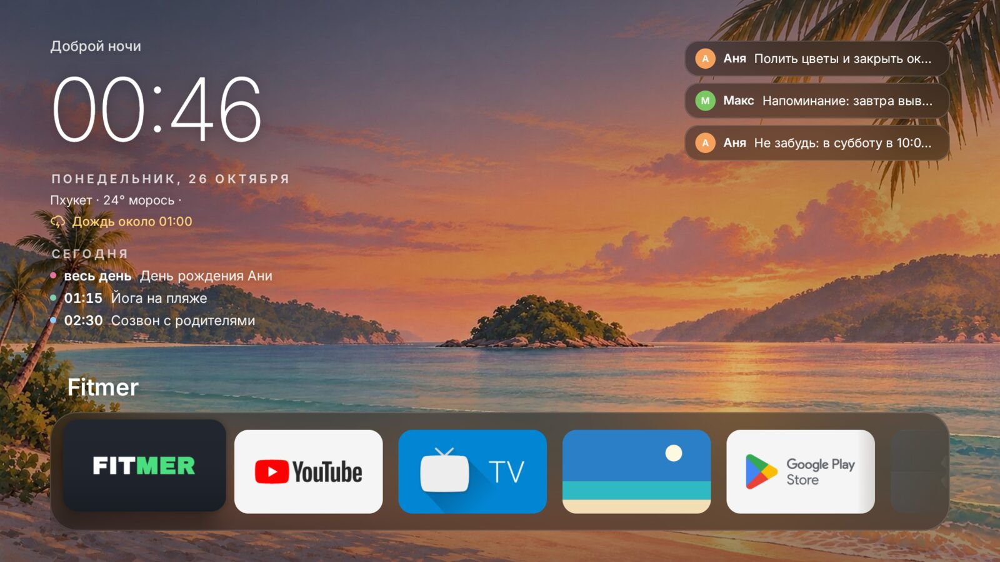
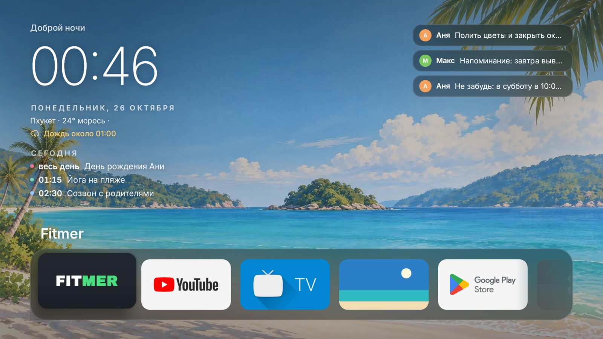
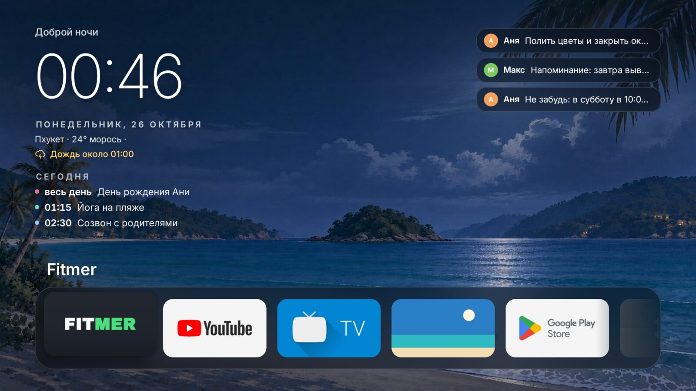
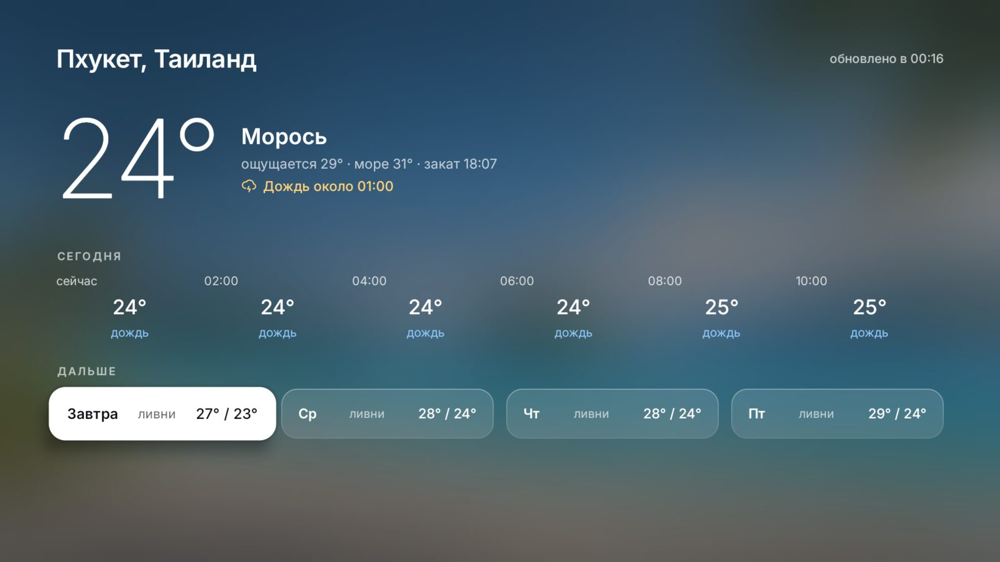
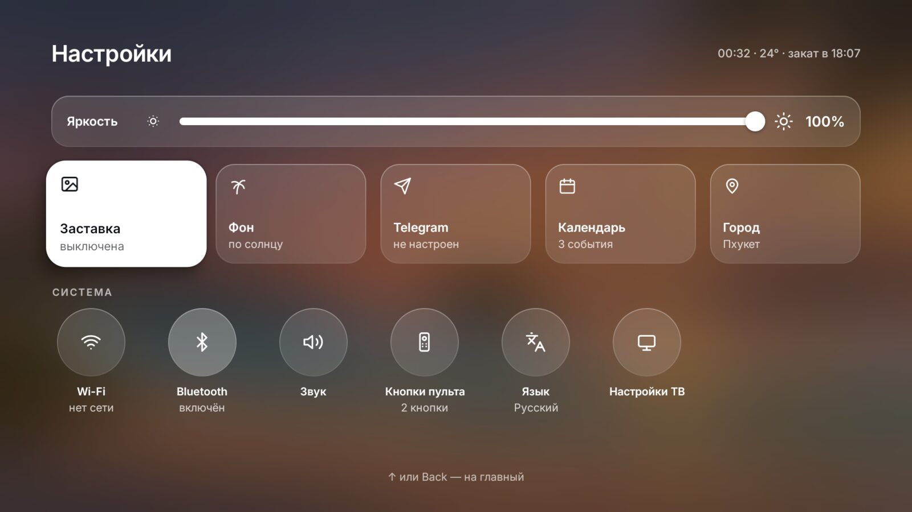
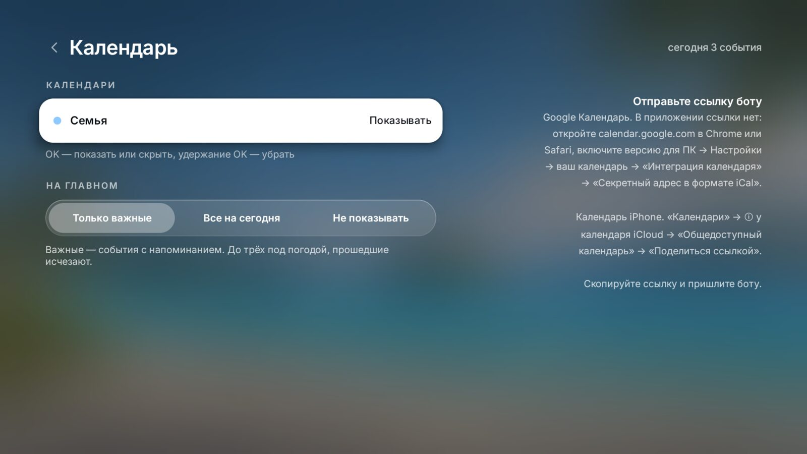
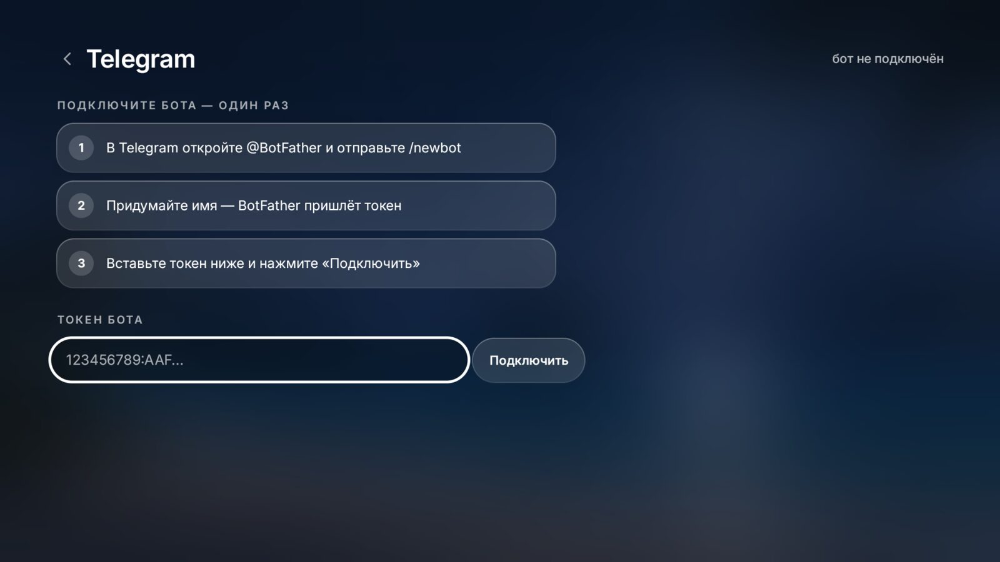
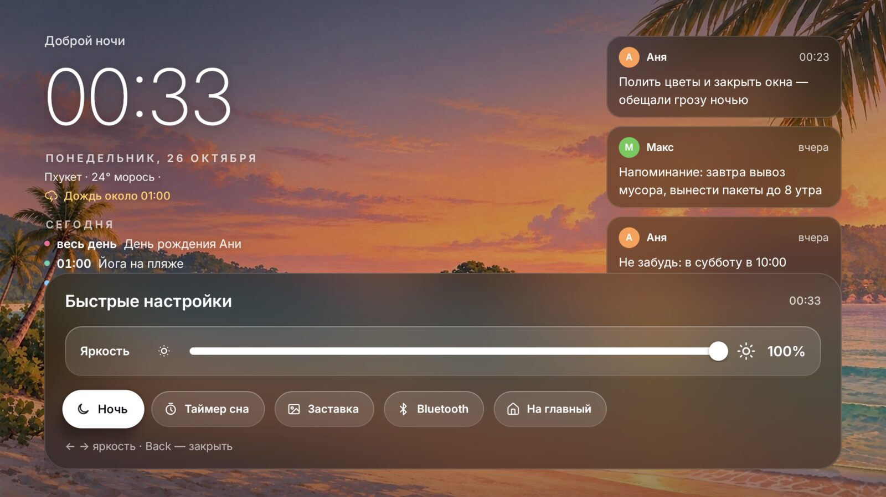

# Lagoon TV

Свой лаунчер для Android TV, сделанный под Xiaomi TV Stick 4K (Android 11).
За главным экраном живёт тропическая бухта: картинка меняется с утра до ночи
по восходу и закату, поверх неё часы, погода, события календаря, напоминания
из Telegram и док с приложениями.

Чистая Java, без AndroidX и сторонних библиотек, весь интерфейс собран в коде.



| Днём | Ночью |
|---|---|
|  |  |

| Погода | Настройки |
|---|---|
|  |  |

| Календарь | Подключение Telegram |
|---|---|
|  |  |

| Быстрая панель (удержание Prime Video) |
|---|
|  |

Имена, события и сообщения на скриншотах выдуманы ([tools/mock_data.py](tools/mock_data.py)).

## Что умеет

- **Фон**: бухта в четырёх состояниях (утро, день, закат, ночь), видео или
  неподвижные картинки; время суток — по восходу и закату города.
- **Матовое стекло** в стиле tvOS: док, заметки и страницы размывают бухту
  под собой, фокус — белая подсветка без рамок.
- **Быстрая панель** по удержанию Prime Video поверх любого приложения:
  яркость бегунком, «Ночь», таймер сна, заставка, Bluetooth.
- **Шесть языков**: русский, английский, тайский, китайский, испанский,
  немецкий.
- **Погода** из Open-Meteo: строка под часами, предупреждение о грозе и дожде,
  экран с почасовым прогнозом, температурой моря и прогнозом на 6 дней.
- **Напоминания через Telegram**: свой бот, приглашение по QR-коду, доступ
  только тем, кого одобрили на телевизоре. Текст, фото, GIF, голосовые, кружки
  и видео появляются справа на главном экране — целыми сообщениями или
  короткими строками, как список дел (переключается на странице Telegram).
- **Календарь** по секретной iCal-ссылке (Google, iCloud): события на сегодня
  под погодой.
- **Заставка**: фото из общего альбома iCloud, по одному, два или три на экране.
- **Док** с приложениями: закрепление, перестановка, удаление.
- **Кнопки пульта**: назначить приложение или действие (панель, «Ночь»,
  заставка, таймер сна) на нажатие и удержание любой кнопки, в том числе
  Netflix и Prime Video.
- **Настройки под себя**: пункты переставляются и скрываются долгим OK;
  кнопка VPN открывает любое установленное VPN-приложение.
- **Свет и ночь**: затемнение экрана поверх всего.

## Сборка и установка

Нужны JDK 17 и Android SDK.

```bash
./gradlew assembleDebug
adb install -r app/build/outputs/apk/debug/app-debug.apk
```

Часть функций требует разрешений, которые выдаются один раз через ADB.
Команды — в [docs/device.md](docs/device.md).

## Документация

- [docs/architecture.md](docs/architecture.md) — классы, потоки, данные, сеть
- [docs/design-system.md](docs/design-system.md) — цвета, шрифт, размеры, компоненты, фокус
- [docs/scene.md](docs/scene.md) — сцена бухты и время суток
- [docs/performance.md](docs/performance.md) — как не тормозить на слабом стике
- [docs/testing.md](docs/testing.md) — эмулятор, отладочные флаги, моки, скриншоты
- [docs/device.md](docs/device.md) — установка на стик, ADB-разрешения, заставка
- [docs/launchers.md](docs/launchers.md) — чужие лаунчеры, откуда брали идеи

## Лицензия

Код — [MIT](LICENSE). Шрифт Inter — SIL Open Font License
([OFL-Inter.txt](OFL-Inter.txt)). Иконки — [Lucide](https://lucide.dev) (ISC, [LICENSE-lucide.txt](LICENSE-lucide.txt)).
